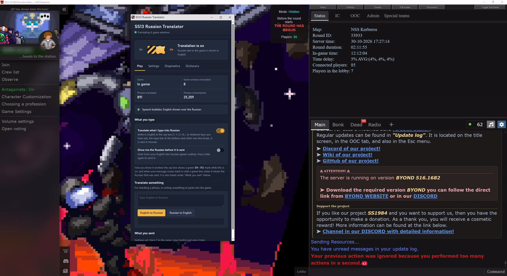
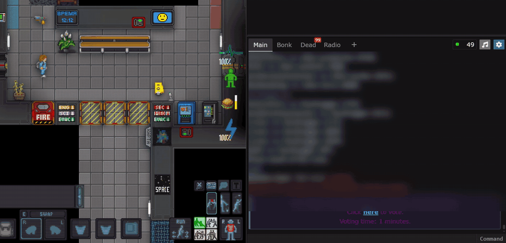
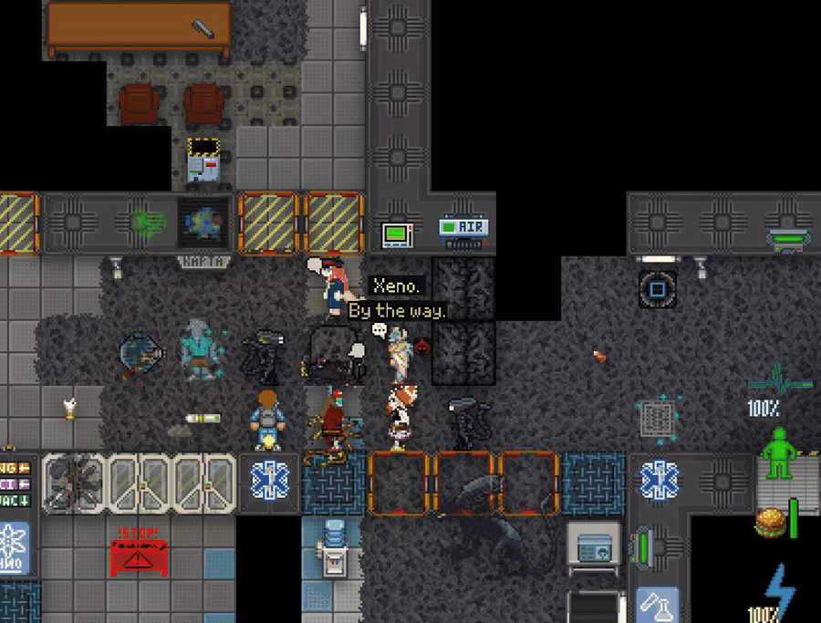

# SS13 Russian Translator

**Play on Russian Space Station 13 servers without speaking Russian.** Everything the game shows you in Russian is turned into English live, while you play: chat, menus, every TGUI window, speech bubbles over people's heads, hover names, the white pop-up messages. What you type in English is sent to the server in Russian.

Made for **SS1984 / SS220 (Paradise)**. It works on any BYOND 516 server, but the game dictionaries are built from that codebase.

**[⬇ Download the latest release](https://github.com/Wafflesome/ss13-russian-translator/releases/latest)**, then see [Installing](#installing).

> [!WARNING]
> ## This is vibecoded slop
> Pretty much every line of this was written by an AI over a lot of chat sessions, for one person who wanted to play on Russian servers.
>
> - It **works on my machine**. It may not work on yours.

### What it looks like

**The lobby as the server sends it**, with translation off in the control panel:

**The same lobby a few seconds later**, with translation on: menu, stat panel, chat and the server's window titles are all in English.

**Typing in English.** Type into the say box as normal (it shows a green EN→RU mark). The server gets Russian, and the chat shows your English line with a green "sent in Russian" line under it.

**Speech bubbles.** The Russian bubbles over people's heads get English drawn over them, and the English stays on the right person while they and the camera move. (You'll see the odd Russian bubble for a moment before its translation arrives.)

---

## Contents

- [What it translates](#what-it-translates)
- [Requirements](#requirements)
- [Installing](#installing)
- [Playing](#playing)
- [Typing in English](#typing-in-english)
- [Speech bubbles and other text on the map](#speech-bubbles-and-other-text-on-the-map)
- [The control panel and the Dictionary](#the-control-panel-and-the-dictionary)
- [Is it safe / can I get banned?](#is-it-safe--can-i-get-banned)
- [Privacy](#privacy)
- [How it works](#how-it-works)
- [Files](#files)
- [Troubleshooting](#troubleshooting)
- [Credits and licenses](#credits-and-licenses)

---

## What it translates

| Where | What happens |
|---|---|
| **Chat** | Every message, names, radio, OOC, admin PMs, history after reconnecting. |
| **Stat panel, lobby, round info** | Tabs, status lines, verb buttons. |
| **Every TGUI window** | Machines, vendors, PDA, character setup, crafting, paper, tooltips, placeholders. |
| **Old HTML pop-ups and the native buttons** around the map | Меню, Полный экран, Сказать … become Menu, Full screen, Say … |
| **Speech bubbles** over people's heads | Covered with the English in the game's own pixel font, colour and size, and the box **follows the person as they walk**. |
| **Hover names** (the name at the top of the map) | Translated in the same font. |
| **Balloon alerts**: the white text that floats up for a second ("не является пищей!", "нет места!") | Read off the map and covered with English. All ~1,700 alerts in the server code are pre-translated, so most appear instantly. |
| **What you type** | Sent in Russian (see [Typing in English](#typing-in-english)). |

Not translated: text baked into sprites and images, voice-over audio, the right-click menu and the command bar's autocomplete (those are native Windows controls listing game commands).

---

## Requirements

- **Windows 10 (2004 or newer) or Windows 11.**
- **BYOND 516** (the version that uses the Edge WebView2 browser for its interface), installed normally.
- An internet connection. Translation uses the free Google Translate service by default (DeepL with your own API key is optional).
- Nothing else. There is no installer and no admin rights are needed. The first start downloads the [Bun](https://bun.sh) JavaScript runtime (about 40 MB, the official build, checked against a fixed SHA-256) into the `runtime` folder.

---

## Installing

1. Go to **[Releases](https://github.com/Wafflesome/ss13-russian-translator/releases/latest)** (also on the right side of this page) and download **`SS13-Russian-Translator-vX.Y.Z.zip`** under *Assets*.
   (Or take the newest code with **Code → Download ZIP**. It's the same files plus the screenshots.)
2. Unpack the zip anywhere, for example on your desktop. Right-click → **Extract All…**, don't run it from inside the zip.
3. Open the `SS13 Russian Translator` folder and double-click **`SS13 Russian Translator.cmd`**.
   - The first time, it downloads Bun into `runtime\`.
   - It also puts a shortcut with the translator's icon in the folder and on your desktop.
4. That's it. To uninstall, close everything and delete the folder (and the desktop shortcut).

---

## Playing

1. Start the game with **`SS13 Russian Translator.cmd`** (or the shortcut). Any open BYOND windows close, BYOND reopens with translation on, and the control panel opens next to it.
2. Join a server from BYOND as usual.
3. Keep the black console window open while you play. Closing it stops the translator.

Hotkeys inside the game:

| Keys | What it does |
|---|---|
| **Ctrl+Alt+T** | Switch every window between the original Russian and the English. |
| **Ctrl+Alt+S** | Open the control panel (or open `http://127.0.0.1:9230` in any browser). |
| **Ctrl+Enter** | In any text box: translate what you wrote into Russian without sending it. |

`JOIN LAST SERVER.cmd` does the same as the main one but goes straight back into the last server you played on.

---

## Typing in English

The switch **Play → Translate what I type into Russian** (on by default) controls all of this:

| Where you type | What happens |
|---|---|
| **Say box** (T say, Y radio, O OOC, M emote …) | Press **Enter**: your English becomes Russian and is sent. Radio and channel prefixes (`; `, `:h `, `*` …) are kept. |
| **Input bar** at the bottom | Pause for about a second: the text turns into Russian, then press Enter. |
| **Other one-line boxes** (TGUI pop-ups, PDA …) | Press **Enter**: translated, then submitted. |
| **Text boxes with Accept / Confirm** (records, flavour text …) | Click **Accept**: the text is translated, shown, and accepted. |
| **Name boxes** | Names are **written in Russian letters, not translated by meaning**: "John Smith" becomes "Джон Смит". You see it first, and the second Enter or Accept sends it. Many servers require Cyrillic names. |
| **Search boxes** (navigation, list pickers, vendors) | Type part of the English name you see ("grav") and press Enter: the box gets the game's Russian name ("Генератор гравитации") and the list shows it. |
| Already typed in Russian? | Nothing changes. Only mostly-English text is translated. |

- A green line under your chat message shows the exact Russian the server received.
- **Show me the Russian before it is sent** makes the first Enter only translate, so you can check it before pressing Enter again.
- **Your character is: Male / Female** (the slider under *What you type*). Russian shows the speaker's gender ("я устал" / "я устала", "я готов" / "я готова"), and the translation service just guesses. With the slider set, what you write about yourself always comes out in your character's gender; words about other people are left alone.
- Chat English is cleaned up first, so "idk", "u", "gonna", typos and SS13 slang (sec, borg, maints, ling …) come out right.
- SS13 jargon goes both ways: "maints" → техи, "HoS" → ГСБ, "revs" ↔ ревы and so on.

---

## Speech bubbles and other text on the map

BYOND draws the map itself, outside its browser, so map text can't be changed in place. Instead, a small **overlay window** draws the English over the Russian:

- **Reading the screen.** It finds the bubbles on the screen picture and reads them letter by letter against the exact pixel fonts the server uses. This is not OCR guessing: the fonts are known pixel for pixel.
- **Speech bubbles** are matched to the chat line they came from, using the words read plus the speaker's colour, place and timing, so the English is the same as in chat. When it isn't sure, it leaves the bubble alone rather than show the wrong English.
- **Following.** The box follows a moving bubble about 30 times a second.
- **Hover names** and **balloon alerts** are read and translated directly.
- **Screenshots.** On Windows 10 2004+ and Windows 11 the boxes are hidden from screen capture, so **screenshots, recordings and streams show the Russian**. To record the English, turn on *Settings → Screen → Show the boxes in screenshots*.

---

## The control panel and the Dictionary

- **Play**: on/off, the typing switch, a box to translate any phrase both ways, and the messages you sent.
- **Settings**: translation service (Google or DeepL), the DeepL API key, map overlay look (font, box size, colour), how the game starts.
- **Diagnostics**: Russian still on screen, the activity log, buttons to open logs or forget saved translations.
- **Dictionary**: everything the translator has saved, searchable. Correct any line and your fix is used from then on (and shows in the open game windows straight away). You can also give a Russian word a fixed English meaning in every sentence, or correct the Russian that gets sent for something you type. Your fixes live in `data/overrides.json`, `data/overrides_outgoing.json` and `data/lexicon_game.json`.

---

## Is it safe / can I get banned?

**Honest answer: probably not, but I can't promise anything, and it's your account.** Here is exactly what it does, so you can judge for yourself or ask your server's admins:

- **Interface windows.** BYOND 516 draws chat, panels and TGUI windows with Microsoft's WebView2 browser. The translator starts BYOND with that browser's standard **developer port** switched on, using Microsoft's documented per-program WebView2 setting in your user registry. The port only listens on `127.0.0.1`, so only your own PC can reach it.
- **What it changes.** Only the visible words on your screen. Links, buttons, commands and game data are never modified. Clicking a translated button sends exactly what it sent before.
- **What it leaves alone.** Nothing is injected into BYOND's memory, no game files are changed, and network traffic isn't touched.
- **The map overlay** only looks at the screen and draws its own window on top. It never clicks, types or sends anything.
- **The server** only ever receives text you chose to send, in Russian.
- **It doesn't play for you.** There's no automation of any game action, no macros, no ESP, and no information you couldn't see anyway.

Some servers have rules about language in IC chat or about client modifications. **Read your server's rules** and ask an admin if unsure. Not affiliated with, or endorsed by, BYOND, SS1984, SS220 or any server.

`REMOVE DEBUG SETTING.cmd` removes the registry setting if the translator was killed and you want BYOND back to normal immediately. Normally it removes the setting itself when it stops.

---

## Privacy

- **What gets sent.** Text to translate goes to the translation service you pick: Google Translate by default, or DeepL with your own key. That includes other players' chat and what you type. The only other connections are reading the public SS220 wiki every two weeks (for game words) and downloading Bun on the first start. There's no telemetry to anyone.
- **What stays on your PC.** Everything else: `cache/` (saved translations), `logs/` (detailed logs, on by default, to find bad translations) and `config.json`. Delete them whenever you like.
- **Turning logs off.** *Diagnostics → Detailed logs* turns most logging off.

---

## How it works

| Part | What it is |
|---|---|
| `src/bridge.js` | The main program (runs on Bun): starts BYOND, connects to its WebView2 windows over the DevTools protocol, serves the control panel. |
| `src/inject.js` | Runs inside the game windows: swaps Russian text nodes for English, handles what you type. |
| `src/translator.js` | Translation engines (Google ways, DeepL), the saved-translation cache, game dictionaries, slang, accent and stutter clean-up, corrections. |
| `src/english.js` | Cleans up chat English before it is translated. `src/translit.js` writes names in the other alphabet. `src/gender.js` puts what you say about yourself in your character's gender. |
| `src/overlay.js` + `overlay/*.cs` | The map overlay: a small C# program (compiled on first start by Windows' own C# compiler) that finds and reads map text and draws the English boxes, plus the logic that pairs bubbles with chat lines. |
| `data/` | Game dictionaries built from the server code (object names, interface strings), SS13 slang, hand-checked corrections, pre-translated balloon alerts. |
| `ui/panel.html` | The control panel. |

---

## Files

| File | What it is |
|---|---|
| `SS13 Russian Translator.cmd` | **Start here.** |
| `JOIN LAST SERVER.cmd` | Same, then rejoins the last server. |
| `REMOVE DEBUG SETTING.cmd` | Only if the translator was killed (see above). |
| `data/names.json`, `data/names_en_ru.json`, `data/warmup.json` | Object names and interface strings from the server code. |
| `data/lexicon_game.json`, `data/glossary.json`, `data/slang.json`, `data/phrases.json` | Game words, abbreviations, slang and whole chat lines, both ways. Edit freely; saving applies them live. |
| `data/corrections.json` | Hand-checked fixes for translations the machine gets wrong, rules that keep SS13 terms consistent, and the pre-translated balloon alerts. |
| `data/wiki_offline.json` | Names from the SS220 wiki. A fresher `wiki_lexicon.json` is downloaded in the background every two weeks. |
| `data/overrides*.json` | Your own fixes from the Dictionary page (empty at first). |
| `tools/` | Scripts to rebuild the data from a newer server source (`build_data.py`), rebuild the pixel fonts (`build_font.py`), summarise the logs (`analyze_logs.py`), and download Bun (`get_bun.ps1`). |
| `config.json` | Created when you change a setting. Every option is in the control panel. |

---

## Troubleshooting

- **"Failed to load fancy chat" / blank lobby or stat panel.** BYOND's panels share one browser engine and refuse to load if it was started with mixed settings. Close BYOND and the translator, then start `SS13 Russian Translator.cmd` again. The translator usually notices and restarts BYOND cleanly by itself.
- **The panel says "Waiting for BYOND to start" while you're in a game.** BYOND was started before the translator. Close BYOND and start it through the translator.
- **"The translation service is not answering".** Check your internet; free Google can rate-limit after heavy use. It retries by itself, or pick DeepL in Settings.
- **Some Russian is still visible.** It's listed under *Diagnostics* and in `logs/leftovers.txt`.
- **A speech bubble stays Russian.** Bubbles over very busy or same-coloured floors can be unreadable. Those are only labelled when the speaker's colour and position make it certain.
- **Bun didn't download.** Get `bun-windows-x64.zip` (version 1.3.5) from [the Bun releases page](https://github.com/oven-sh/bun/releases) and put `bun.exe` into the `runtime` folder.

---

## Credits and licenses

- **This project**: [GNU AGPL-3.0](LICENSE). The game data in `data/` (object names, interface strings, balloon alerts) is taken from the [SS1984](https://github.com/ss220-space) / [Paradise](https://github.com/ParadiseSS13/Paradise) server code, which is AGPL-3.0.
- **Fonts** in `overlay/fonts/` are pixel patterns of the fonts the server uses: Grand9K Pixel by Jayvee Enaguas (CC BY 4.0) and Pixellari by Zacchary Dempsey-Plante. See `overlay/fonts/license.txt`.
- **Runtime**: [Bun](https://bun.sh) (MIT), downloaded on first start, not included.
- **Translation**: Google Translate or DeepL, depending on your settings. Their terms apply to what you send them.
- **Code**: written by Claude (Anthropic) at the direction of a player who just wanted to understand what everyone was saying. See the warning at the top.
